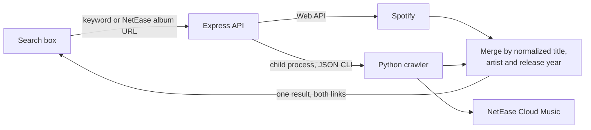

<div align="center">

# While Listening to Albums

**A private-first music journal: log the albums you listen to, rate them, and write down what you were thinking.**

[](LICENSE)


**English** · [简体中文](README.zh-CN.md)

</div>

---

## Overview

While Listening to Albums (听专辑的时候我在想些什么) is a self-hostable web app for people who listen to albums front to back and want to remember what they thought. Search an album once and get it from **Spotify and NetEase Cloud Music at the same time**, add it to your list, and write listening notes that stay private unless you decide otherwise.

It is similar in spirit to the album pages of Douban, with a different set of priorities: your notes are yours, ratings are finer than five stars, and every album links straight to where you can play it.

## Features

- **Accounts** — register and log in with a username or email. Passwords are hashed with bcrypt, sessions are JWTs, and login attempts are rate limited.
- **One search, two platforms** — a keyword is searched on Spotify and NetEase Cloud Music concurrently. The same album found on both sides is merged into a single result that carries both streaming links. If one platform is down, you still get the other.
- **Paste a NetEase link** — give the search box a NetEase album URL; the crawler reads the album and the server looks up its Spotify counterpart.
- **Your own list** — albums and singles you add belong to your account. The album catalog is shared between users, your list is not.
- **Listening notes** — write blogs that refer to one or more albums, rated from 1 to 10 with decimals. **Private by default**; a note can be made public and shared by link.
- **Jump to streaming** — every album links to Spotify and/or NetEase Cloud Music.
- **Unicode-friendly** — Chinese, Japanese and Korean titles work everywhere, including URLs.

## Roadmap

- [ ] Album cover collages ("everything I listened to in 2026"), exportable with one click, with a one-word or one-color "quick impression" per album
- [ ] Calendar view of the collage, with empty slots for quiet days
- [ ] "On This Day": what you were listening to a year ago, and how you rated it
- [ ] Listening heatmap in the style of the GitHub contribution graph, backed by multiple listening logs per album
- [ ] Timeline view with covers and notes
- [ ] Rating trends: are you becoming more generous, or more critical?
- [ ] Want-to-listen list, with optional email reminders
- [ ] More streaming platforms

## Quick Start

The only requirement is [Docker](https://docs.docker.com/get-docker/).

```bash
git clone https://github.com/SuQichen777/While-Listening-to-Albums.git
cd While-Listening-to-Albums
cp .env.example .env
```

Fill in `SPOTIFY_CLIENT_ID`, `SPOTIFY_CLIENT_SECRET` and `JWT_SECRET` in `.env`, then:

```bash
docker compose up --build -d
```

Open <http://localhost:3000> and register an account.

> [!NOTE]
> Spotify requires the owner of a Spotify app to have an active Premium subscription, otherwise its Web API answers `403`. The app keeps working in that case: the search page shows a warning and lists NetEase results only.

To run the pieces without Docker, see **[Local Development](docs/local-development.md)**.

## How Search Works



Both sources are queried concurrently and either one may fail independently. The response reports a status per source, so the client can tell the user what is missing instead of failing the whole search.

## Tech Stack

| Layer | Technology |
| --- | --- |
| Frontend | React 19, React Router 7, Vite |
| Backend | Node.js, Express 4, Mongoose 8 |
| Auth | bcrypt password hashing, JSON Web Tokens, express-rate-limit |
| Database | MongoDB |
| Crawler | Python 3, requests, BeautifulSoup |
| External APIs | Spotify Web API, NetEase Cloud Music |
| Testing | Mocha, Chai, SuperTest, mongodb-memory-server, ESLint |
| Deployment | Docker (multi-stage build), Docker Compose |

## Project Structure

```text
While-Listening-to-Albums/
├── client/                     React app (Vite)
│   └── src/
│       ├── components/         Tabs, SearchBar, StreamingLinks, ProtectedRoute, ...
│       ├── context/            AuthProvider, useAuth
│       ├── pages/              Login, Register, MusicList, MusicSearch, MusicDetail, Blog*
│       └── lib/api.js          fetch helper that attaches the login token
├── server/                     Express API
│   ├── src/
│   │   ├── app.mjs             entry point, also serves client/dist
│   │   ├── models/db.mjs       User, Artist, Music, Mark, Blog
│   │   ├── middleware/auth.mjs JWT signing and requireAuth
│   │   ├── routes/             authRoutes, musicRoutes, blogRoutes
│   │   └── services/           spotify, netease (crawler bridge), merge
│   └── test/                   Mocha + Chai + SuperTest
├── crawler/                    NetEase Cloud Music crawler (Python)
│   ├── get_album.py            album page / JSON API / search
│   └── cli.py                  JSON command line used by the server
├── docs/                       development guides
├── Dockerfile
└── docker-compose.yml
```

## API

All endpoints live under `/api/v1`. Everything except `auth/register` and `auth/login` requires an `Authorization: Bearer <token>` header.

| Method | Path | Description |
| --- | --- | --- |
| `POST` | `/auth/register` | Create an account, returns `{ token, user }` |
| `POST` | `/auth/login` | Log in with username or email, returns `{ token, user }` |
| `GET` | `/auth/me` | The user of the current token |
| `POST` | `/music/search` | Search Spotify and NetEase by keyword or NetEase album URL |
| `POST` | `/music/add` | Add one search result to your list |
| `GET` | `/music/all` | Your list |
| `GET` | `/music/:slug` | Album details |
| `DELETE` | `/music/:slug` | Remove an album from your list |
| `POST` | `/blog/create` | Write a listening note |
| `GET` | `/blog/all` | Your notes |
| `GET` | `/blog/:slug` | One note (your own, or a public one) |

Request and response bodies are documented in [Local Development](docs/local-development.md#api).

## Testing

```bash
npm test
```

The server suite covers the data models, registration and login, per-user data isolation, the search merge logic and the Spotify / NetEase mappers. It runs against an in-memory MongoDB, so no database is needed.

## Contributing

Issues and pull requests are welcome. Please run `npm test` and the linters (`npm --prefix server run lint`, `npm --prefix client run lint`) before opening a pull request.

## Acknowledgements

- [Spotify Web API](https://developer.spotify.com/documentation/web-api)
- [NetEase Cloud Music](https://music.163.com/) — this project is not affiliated with NetEase; the crawler only reads publicly available album metadata. Please use it responsibly.

## License

[MIT](LICENSE) © SuQichen777
