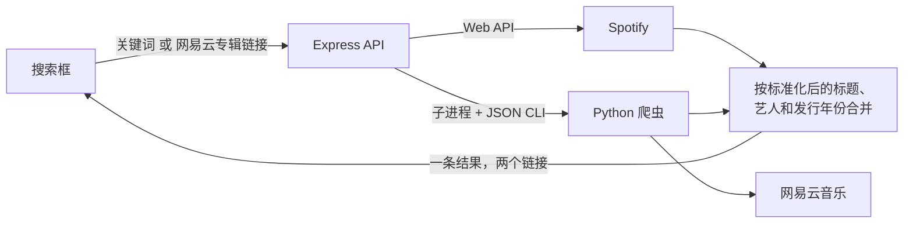

<div align="center">

# 听专辑的时候我在想些什么

**一款私人优先的听歌记录软件：记录你听过的专辑，给它们打分，写下当时的想法。**

[](LICENSE)


[English](README.md) · **简体中文**

</div>

---

## 简介

听专辑的时候我在想些什么（While Listening to Albums）是一款可以自己部署的网页应用，写给那些喜欢把一张专辑从头听到尾、并且想记住自己当时在想什么的人。搜索一次，就能**同时从 Spotify 和网易云音乐**找到这张专辑，把它加入自己的列表，然后写下听歌笔记——除非你主动公开，否则这些笔记只有你自己能看到。

你或许会觉得这款软件和豆瓣的专辑页面很像，其实确实如此。不过它的侧重点不太一样：笔记是你自己的，评分比五颗星更细，每张专辑都能直接跳转到能播放它的地方。

## 功能

- **用户系统**：用用户名或邮箱注册、登录。密码使用 bcrypt 哈希存储，登录状态使用 JWT，登录接口有频率限制。
- **一次搜索，两个平台**：关键词会同时在 Spotify 和网易云音乐上搜索。两边搜到的同一张专辑会合并成一条结果，同时带有两个平台的链接。其中一个平台出问题时，另一个平台的结果照常返回。
- **直接粘贴网易云链接**：在搜索框里贴一个网易云专辑链接，爬虫会读取专辑信息，服务器再去 Spotify 找到对应的专辑。
- **属于你自己的列表**：你添加的专辑和单曲属于你的账号。专辑库在用户之间共享，但你的列表不会。
- **听歌笔记**：写一篇 Blog，可以关联一张或多张专辑，评分是 1-10 分并且支持小数。**默认完全私密**，也可以设为公开后通过链接分享。
- **跳转流媒体**：每张专辑都可以直接跳转到 Spotify 和/或网易云音乐。
- **对中文友好**：中文、日文、韩文的标题在任何地方都能正常使用，包括 URL。

## 开发计划

- [ ] 专辑封面拼图（“我 2026 年听过的所有专辑”），一键导出，并且可以给每张专辑加一个词或者一个颜色的“简单印象”
- [ ] 把拼图做成“月历”，没听歌的日子就留空
- [ ] “那年今日”：去年的今天你在听什么，当时打了多少分
- [ ] 像 GitHub 贡献图一样的听歌热力图，所以每张专辑会允许有多条听歌记录
- [ ] 带封面和笔记的时间轴
- [ ] 评分曲线：我最近变成“懂哥”了吗？我最近变得“苛刻”了吗？
- [ ] “想听”列表，以及可选的邮件提醒
- [ ] 更多流媒体平台

## 快速开始

只需要安装 [Docker](https://docs.docker.com/get-docker/)。

```bash
git clone https://github.com/SuQichen777/While-Listening-to-Albums.git
cd While-Listening-to-Albums
cp .env.example .env
```

在 `.env` 里填好 `SPOTIFY_CLIENT_ID`、`SPOTIFY_CLIENT_SECRET` 和 `JWT_SECRET`，然后：

```bash
docker compose up --build -d
```

打开 <http://localhost:3000>，注册一个账号就可以开始用了。

> [!NOTE]
> Spotify 要求 Spotify app 的所有者拥有有效的 Premium 订阅，否则 Web API 会返回 `403`。这种情况下应用依然可以使用：搜索页会给出提示，并且只显示网易云的结果。

如果不想用 Docker，请参考 **[本地开发](docs/local-development.zh-CN.md)**。

## 搜索是怎么工作的



两个来源是并发查询的，任何一个都可以单独失败。响应里会带上每个来源的状态，所以前端可以告诉用户缺了什么，而不是让整次搜索失败。

## 技术栈

| 层 | 技术 |
| --- | --- |
| 前端 | React 19、React Router 7、Vite |
| 后端 | Node.js、Express 4、Mongoose 8 |
| 认证 | bcrypt 密码哈希、JSON Web Token、express-rate-limit |
| 数据库 | MongoDB |
| 爬虫 | Python 3、requests、BeautifulSoup |
| 外部 API | Spotify Web API、网易云音乐 |
| 测试 | Mocha、Chai、SuperTest、mongodb-memory-server、ESLint |
| 部署 | Docker（多阶段构建）、Docker Compose |

## 项目结构

```text
While-Listening-to-Albums/
├── client/                     React 前端 (Vite)
│   └── src/
│       ├── components/         Tabs, SearchBar, StreamingLinks, ProtectedRoute, ...
│       ├── context/            AuthProvider, useAuth
│       ├── pages/              Login, Register, MusicList, MusicSearch, MusicDetail, Blog*
│       └── lib/api.js          自动带上登录 token 的 fetch 封装
├── server/                     Express API
│   ├── src/
│   │   ├── app.mjs             入口，同时 serve client/dist
│   │   ├── models/db.mjs       User, Artist, Music, Mark, Blog
│   │   ├── middleware/auth.mjs JWT 签发与 requireAuth
│   │   ├── routes/             authRoutes, musicRoutes, blogRoutes
│   │   └── services/           spotify, netease（调用爬虫）, merge
│   └── test/                   Mocha + Chai + SuperTest
├── crawler/                    网易云音乐爬虫 (Python)
│   ├── get_album.py            专辑页 / JSON 接口 / 搜索
│   └── cli.py                  给后端调用的 JSON 命令行
├── docs/                       开发文档
├── Dockerfile
└── docker-compose.yml
```

## API

所有接口都在 `/api/v1` 下。除了 `auth/register` 和 `auth/login`，其他接口都需要带上 `Authorization: Bearer <token>` 请求头。

| 方法 | 路径 | 说明 |
| --- | --- | --- |
| `POST` | `/auth/register` | 注册，返回 `{ token, user }` |
| `POST` | `/auth/login` | 用用户名或邮箱登录，返回 `{ token, user }` |
| `GET` | `/auth/me` | 当前 token 对应的用户 |
| `POST` | `/music/search` | 用关键词或网易云专辑链接同时搜索 Spotify 和网易云 |
| `POST` | `/music/add` | 把一条搜索结果加入自己的列表 |
| `GET` | `/music/all` | 自己的列表 |
| `GET` | `/music/:slug` | 专辑详情 |
| `DELETE` | `/music/:slug` | 把一张专辑从自己的列表里移除 |
| `POST` | `/blog/create` | 写一篇听歌笔记 |
| `GET` | `/blog/all` | 自己的笔记 |
| `GET` | `/blog/:slug` | 一篇笔记（自己的，或者别人公开的） |

请求和响应的具体格式见[本地开发](docs/local-development.zh-CN.md#api)。

## 测试

```bash
npm test
```

后端测试覆盖了数据模型、注册与登录、用户之间的数据隔离、搜索结果的合并逻辑，以及 Spotify / 网易云的数据映射。测试使用内存中的 MongoDB，不需要准备数据库。

## 参与贡献

欢迎提 issue 和 pull request。提交之前请先跑一遍 `npm test` 和 lint（`npm --prefix server run lint`、`npm --prefix client run lint`）。

## 致谢

- [Spotify Web API](https://developer.spotify.com/documentation/web-api)
- [网易云音乐](https://music.163.com/)：本项目与网易没有任何关系，爬虫只读取公开的专辑信息，请合理使用。

## 许可证

[MIT](LICENSE) © SuQichen777
